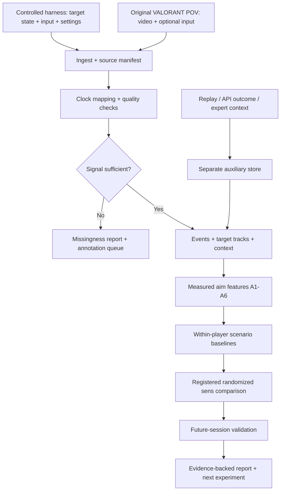

# Xương sống hệ thống v0.1

Luồng ưu tiên là **controlled measurement → sens experiment → natural transfer → post-session coaching**. Khởi đầu trong một aiming harness có state chuẩn giúp tách lỗi phép đo khỏi lỗi computer vision. Gameplay VALORANT được đưa vào khi có metric nền để đối chiếu.

Mũi tên auxiliary → events chỉ dùng để định vị episode hoặc bổ sung context với provenance. Dữ liệu server/omniscient không được thay thế original POV timing hoặc tự biến thành player knowledge.

## Sáu khối để triển khai

| Khối | Input → output | Cách làm tối thiểu | Điều kiện chuyển tiếp |
|---|---|---|---|
| 1. Acquisition | Harness logs / video / input → session package | Adapter file trước; Windows recorder sau | Session manifest, settings readback, source kind, hash |
| 2. Measurement | Raw streams → aligned frame/event time | Camera-ground-truth trong harness; QPC mapping nếu tự capture | G0; raw input semantics và uncertainty rõ |
| 3. Perception & segmentation | Frame + state → target tracks, visibility, shot/entry events | State machine minh bạch; detector chỉ khi cần natural video | G1; event coverage và failure reasons |
| 4. Aim analytics | Events → A1–A6 theo scenario | Công thức và personal baseline có version | G2; metric có denominator, missingness và CI |
| 5. Sens study | Trial table + assignment → response estimates | Paired contrasts trước; mixed-effects/GAM khi có đủ dữ liệu | G3; preregistered endpoint và test tách ngày |
| 6. Coach | Findings + clips + uncertainty → report | Template có bằng chứng; LLM tùy chọn để diễn đạt | Mọi số trỏ tới event; không sinh phép đo hay quan hệ nhân quả mới |

### Controlled trước computer vision

Đánh giá [FirstPersonScience](https://github.com/NVlabs/FPSci) làm harness nghiên cứu: có cấu hình scene/target/input và lưu kết quả thí nghiệm. Có thể tái sử dụng sau khi rà license trong [dataset audit](03_datasets.md). Đây là công cụ tạo dataset, không phải dataset VALORANT có sẵn.

Nếu harness không xuất raw device counts, vẫn dùng camera/target ground truth để đo aim; để `raw_mouse_available=false`. Nếu cần phân tích tay/chuột vật lý thì bổ sung logger riêng đã calibration. Không lấy cursor coordinates rồi đổi tên thành counts.

### Natural adapter

V0 nhận video gốc sau trận và file input nếu đã có. Trước khi xây custom recorder, kiểm 5–10 clip với frame timestamps thực, resolution, reticle và target size. Có thể manual annotate để xây gold baseline rồi mới train detector.

Windows cung cấp [Desktop Duplication](https://learn.microsoft.com/en-us/windows/win32/direct3ddxgi/desktop-dup-api) cho frame updates và [Raw Input](https://learn.microsoft.com/en-us/windows/win32/inputdev/about-raw-input) cho HID events. [QPC](https://learn.microsoft.com/en-us/windows/win32/sysinfo/acquiring-high-resolution-time-stamps) là clock đo khoảng thời gian, không tự đồng bộ UTC. Timestamp đặt tại lúc handler nhận event còn chịu queueing; phải đo offset/drift/jitter giữa nguồn, không chỉ lưu cùng một loại timestamp.

Chưa chọn cố định detector/tracker hay mua GPU trong giai đoạn này. Chọn model bằng độ chính xác trên gold target nhỏ/che khuất, runtime sau trận và license; một model thắng benchmark khác chưa đủ làm baseline VALORANT.

## Output contract của coach

| Field | Ý nghĩa |
|---|---|
| `finding_id`, `target_id` | Claim nói về target nào |
| `metric`, `baseline`, `delta`, `unit` | Giá trị đo và phép so sánh; null nếu chưa đo |
| `n_players`, `n_sessions`, `n_events` | Mẫu độc lập và số lần thử tách biệt |
| `scenario_filter`, `exclusion_counts` | Tình huống áp dụng và dữ liệu bị loại |
| `evidence_event_ids`, `source_hashes` | Có thể mở lại clip/record gốc |
| `uncertainty`, `limitations` | Khoảng tin cậy, sai số phép đo, khả năng chuyển giao |
| `status` | `MEASUREMENT_ONLY`, `HYPOTHESIS`, `TEST_CANDIDATE`, `PROSPECTIVELY_SUPPORTED`, `INSUFFICIENT_EVIDENCE` |
| `next_experiment` | Một bài thử cụ thể khi cần thêm bằng chứng |

Confidence của detector được giữ trong QA; nó không thay thế confidence của kết luận sensitivity. Một đường cong khớp lịch sử chỉ có trạng thái `TEST_CANDIDATE`.

## Replay và ranh giới nền tảng

Replay có từ patch 11.06. FAQ Riot mô tả góc nhìn server có thể khác client, không ghi voice/text chat; minimap trong replay có thể vẫn lộ enemy khi đã tắt outlines. Vì vậy replay dùng để xem lại/annotate hậu cảnh; screen capture gốc là nguồn cho first-visible và timing. Ghi `source_kind=replay_render`, mask thông tin không thuộc POV, tách outcome. Những hạn chế này là thông tin của FAQ được kiểm ngày 07/09/2026; không thay thế kiểm client/patch tại ngày thu. [Riot Replay FAQ](https://playvalorant.com/en-gb/news/dev/replays-everything-you-need-to-know/).

Riot liệt kê training dựa trên match history/aggregate stats trong các use case chấp thuận và loại real-time guidance làm thay đổi hành vi ngay trong trận. Product phục vụ người chơi phải đăng ký; luồng app dùng player data cần opt-in/RSO theo policy. Tài liệu API hiện liệt kê content/match/ranked/status, chưa cung cấp luồng raw input hoặc API replay telemetry ở trang này. Thiết kế v0 dùng capture của người tham gia và phân tích sau phiên; việc một API Windows tồn tại không chứng minh collector cụ thể đã được Riot chấp thuận. [VALORANT Developer Policy](https://developer.riotgames.com/docs/valorant).

## Gamesense giữ ở đâu

Hiện chỉ lưu context giúp giải thích aim: target size, visibility, movement, weapon, timing sau contact. Khi mở gamesense, bắt đầu với re-exposure sau contact hoặc reload sau disengage; expert xem pre-action POV, outcome xem ở lượt tách biệt. `unknown` phải tồn tại cho thông tin voice/teammate không thu được.

[ESTA](https://github.com/pnxenopoulos/esta) là nguồn state/action CS:GO; [ggViz](https://arxiv.org/abs/2107.06495) là tham khảo truy xuất tình huống. Cả hai không tạo sẵn nhãn decision quality VALORANT. WPA trong [Valuing Player Actions](https://arxiv.org/abs/2011.01324) thực nghiệm định giá damage events qua thay đổi dự báo thắng; không dùng delta đó làm nhãn “peek đúng” hoặc kết luận về hành động thay thế chưa xảy ra.
